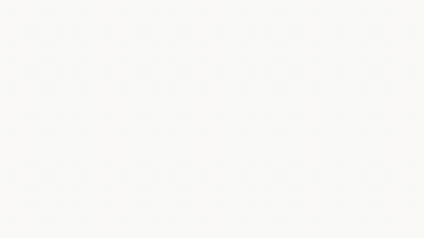
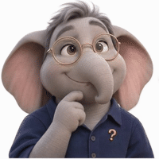

# bot-expression-avatar

[中文](README.md) | **English**

**One 2×2 expression sheet → a bot avatar that changes expression.** The avatar stays still by default; on hover it blinks and breaks into a smile; while the bot is working it switches to a "working" face; while it replies it looks like it's talking.

Works with **OpenMausBot** (expression switches automatically with the bot's state) and **Grok Bot** (a looping four-expression GIF). Use it as an AI agent skill, or just run the scripts.



> HD version: [docs/demo.mp4](docs/demo.mp4) (28 s, Chinese captions)

| State | What you see | File |
|---|---|---|
| Idle | Still, smiling | `name.png` |
| Hover | Blink → smile → back to calm | `name-hover.gif` |
| Working | Switches to the bottom-left face (thinking, skeptical, calculating, surprised…), blinks now and then | `name-busy.gif` |
| Replying | Alternates calm and happy, like talking | `name-talk.gif` |
| Grok Bot | Cycles through all four expressions | `name-grok.gif` |

---

## Contents

- [How it works](#how-it-works)
- [Fastest way: hand the link to your agent](#fastest-way-hand-the-link-to-your-agent)
- [Install](#install)
- [Usage](#usage)
  - [Step 1: Generate a 2×2 expression sheet](#step-1-generate-a-22-expression-sheet)
  - [Step 2: Slice it into a PNG and GIFs](#step-2-slice-it-into-a-png-and-gifs)
  - [Step 3A: OpenMausBot](#step-3a-openmausbot)
  - [Step 3B: Grok Bot](#step-3b-grok-bot)
- [Example](#example)
- [FAQ](#faq)

## How it works

1. Use any AI image generator to make **one** 2×2 expression sheet: the same character, same framing, only the facial expression changes. Getting all four faces in one image keeps the character in the same spot, so switching between them doesn't jump.
2. `make_avatar.py` cuts the four panels, aligns them automatically, and produces 1 still PNG plus 4 GIFs (with cross-fade transitions, not hard cuts).
3. In OpenMausBot, the bot's picture is the still PNG; theme CSS detects three states — mouse hovering, bot busy, message streaming — and swaps in the matching GIF. Grok Bot can't switch by state, so you upload one GIF that cycles through all four faces.

## Fastest way: hand the link to your agent

Tell your agent (OpenMausBot, Claude Code, Codex…):

> Use https://github.com/961882/bot-expression-avatar to make an expression avatar for my bot

It downloads the repo, generates the sheet and slices it. How far it gets depends on its tools:

| Step | Can the agent do it alone? |
|---|---|
| Generate the 2×2 sheet | Yes if it has an image tool; otherwise it gives you the prompt and you send back the image |
| Slice into PNG + GIFs | Yes (needs Python 3 and Pillow) |
| Set the picture and theme in OpenMausBot | Fully automatic for a bot running inside OpenMausBot; other agents hand you the files and steps |
| Change the avatar in Grok Bot | No — you upload `name-grok.gif` in Grok Bot's interface yourself (30 seconds) |

## Install

Requires Python 3 and Pillow:

```bash
pip install pillow
git clone https://github.com/961882/bot-expression-avatar.git
```

**As a skill** (Claude Code, OpenMausBot, or any agent that reads `SKILL.md`):

```bash
# copy into your agent's skills folder, e.g.:
cp -r bot-expression-avatar ~/.agents/skills/      # or ~/.claude/skills/
```

Then ask your agent: "make an expression avatar for this bot". It follows the steps in `SKILL.md` (written in Chinese; agents read it fine).

**Grok Bot**: upload the skill in Grok Bot's own interface (its bots run in the cloud and can't read local folders). Zip the repo, or upload just `SKILL.md`.

## Usage

### Step 1: Generate a 2×2 expression sheet

Use any image generator (GPT Image, Midjourney, etc.). Use this prompt and replace the 【…】 parts:

```text
Character expression sheet, a 2x2 grid of four equal square panels on a pure white
background with no borders or text. Every panel shows the exact same 3D Pixar-style
cartoon 【animal / character】 character, head and shoulders, identical size, position,
camera angle and lighting in every panel: 【appearance details】, round gold wire-rim
glasses, navy blue button-up shirt with collar, small gold 【pin motif】 pin on the chest.
Only the facial expression changes.
Top-left: 【calm and friendly】, eyes open.
Top-right: same as top-left but both eyes closed (blink).
Bottom-left: 【working face: thoughtful / skeptical / calculating / surprised】.
Bottom-right: 【happy, talking: open-mouth smile】.
```

The four panels always mean:

| Top-left | Top-right |
|---|---|
| Calm (the idle avatar) | Blink |
| **Bottom-left** | **Bottom-right** |
| Working face | Happy / talking |

Check the result: the character must be the same size and position in all four panels, on a white background. If not, generate again.

Any style works (2D, pixel art, photoreal…) as long as the four panels line up on white.

### Step 2: Slice it into a PNG and GIFs

```bash
python3 scripts/make_avatar.py sheet.png out_dir name [--size 320]
```

- `--size`: output side length, 320 px by default. Avatars usually render at 40–80 px, so 320 is plenty; use 200 for smaller files.
- Outputs 5 files: `name.png`, `name-hover.gif`, `name-busy.gif`, `name-talk.gif`, `name-grok.gif`.
- The script crops all four panels with the union of their content boxes and aligns the character to the bottom edge, so expressions don't jump.

The timing of each animation is in `make_avatar.py`; change the millisecond values to speed up or slow down.

### Step 3A: OpenMausBot

OpenMausBot has no "animate on hover" switch, so this uses a **theme**: the bot's picture is the still PNG, and the theme CSS swaps in a GIF for each state.

1. **Add the 3 GIFs to a theme**: via a custom theme in Settings → Appearance, or have your bot use the theme tool (`add_theme_asset`) to add `-hover.gif`, `-busy.gif` and `-talk.gif`. Note each file's address, like `/api/theme-assets/<theme id>/xxx.gif`. The app may rename files, so use the address it returns.
2. **Set the still picture**: make `name.png` the bot's picture. Its address becomes `/api/attachments/<attachment id>.png`; note the **first 8 characters** of the attachment id.
3. **Write bots.json** (see [examples/bots.example.json](examples/bots.example.json)), one entry per bot:

   ```json
   [{"botId": "the bot's id", "png": "first 8 chars of the attachment id",
     "hover": "/api/theme-assets/…/hover.gif",
     "busy":  "/api/theme-assets/…/busy.gif",
     "talk":  "/api/theme-assets/…/talk.gif"}]
   ```

4. **Generate the CSS**:

   ```bash
   python3 scripts/maus_css.py bots.json > avatar.css
   ```

5. **Merge it into the theme and wear it.** If the theme already has other rules, merge rather than overwrite.
6. **Test it**: hover over the avatar, give the bot a task, and watch it while it replies.

> When an agent does this for you: OpenMausBot allows at most 10 settings changes per conversation turn. Each bot takes 4 (3 GIFs + 1 picture), so an agent can do about 2 bots per turn and continue on the next.

**How it works** (generated CSS: [examples/avatar.example.css](examples/avatar.example.css)):

| State | UI hook |
|---|---|
| Avatar | `[data-avatar="picture"] img`, matched per bot by `img[src*="first 8 chars of attachment id"]` |
| Working | The bot's sidebar row `[data-sidebar-bot-row="<botId>"]` contains `[data-sidebar-working-phrase]`, or its `aria-label` includes "Working" / "工作中" (note: `aria-busy` on that row means *deleting*, so it can't be used) |
| Replying | Message text `[data-look="bot-text"]` has `data-streaming` |
| Hover | `:hover` |

The CSS swaps images with `content: url(gif)`. Priority: hover > replying > working. With the system's "reduce motion" setting on, every avatar stays still. If an app update breaks it, search the app's front-end code for these hooks again.

### Step 3B: Grok Bot

Grok Bot stores avatars in the cloud, one image per bot, with no state switching.

1. Open Grok Bot → click the bot's name → **Edit bot avatar** → choose an image, and upload `name-grok.gif` (png, jpeg, gif or webp, up to 20 MB).
2. A crop dialog appears. If the avatar stops moving after cropping (the GIF got flattened), upload `name.png` instead.

## Example

A small group of four "thinking partner" bots, each a different animal, with a working face that fits its role:

| Bot | Animal | Sheet | Working face |
|---|---|---|---|
| Thinking coach | Elephant | [elephant.jpg](examples/sheets/elephant.jpg) | Looking up, thinking |
| Business-owner reader | Tiger | [tiger.jpg](examples/sheets/tiger.jpg) | Narrowed eyes, skeptical |
| Cross-border e-commerce reader | Camel | [camel.jpg](examples/sheets/camel.jpg) | Frowning, doing the math |
| AI-enthusiast reader | Meerkat | [meerkat.jpg](examples/sheets/meerkat.jpg) | Wide-eyed, surprised |

Full output for the elephant (`--size 200`) is in [examples/output/](examples/output/):

| Idle | Hover | Working | Replying | Grok Bot |
|---|---|---|---|---|
|  |  |  |  |  |

Try it yourself:

```bash
python3 scripts/make_avatar.py examples/sheets/tiger.jpg out tiger
```

## FAQ

**The character jumps around in the GIF?**
The four panels aren't aligned. Regenerate, stressing `identical size, position, camera angle` in the prompt.

**A slight ghosting when the expression changes?**
Those are the cross-fade frames between expressions — expected. To remove them, set the frame count in `fade()` to 1.

**GIFs too large?**
Use `--size 200`, or reduce the number of `talk` loops from 6.

**Why not have the AI generate a GIF directly?**
Most image services can't output GIFs, and separate generations don't line up. One four-panel sheet, then slicing, is the most reliable.

## License

MIT
