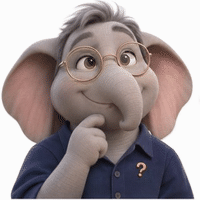

# bot-expression-avatar

**中文** | [English](README.en.md)

**一张四格表情图 → 会变表情的 bot 头像。** 头像平时静止；鼠标移上去会眨眼、笑开；bot 执行任务时换上干活的表情；回复你时一张一合，像在说话。

支持 **OpenMausBot**（按状态自动换表情）和 **Grok Bot**（四种表情轮播）。可以当 AI agent 的 skill 用，也可以直接跑脚本。


> 高清版：[docs/demo.mp4](docs/demo.mp4)（29 秒）

| 状态 | 效果 | 用到的文件 |
|---|---|---|
| 平时 | 静止，微笑 | `名字.png` |
| 鼠标移上 | 眨眼 → 笑开 → 回到平静 | `名字-hover.gif` |
| 执行任务时 | 换成左下格的表情（思考、怀疑、算账、吃惊……），偶尔眨眼 | `名字-busy.gif` |
| 回复时 | 平静和开心交替，像在说话 | `名字-talk.gif` |
| Grok Bot | 一段动图里轮流演四种表情 | `名字-grok.gif` |

---

## 目录

- [它是怎么做的](#它是怎么做的)
- [最快的用法：把链接交给 agent](#最快的用法把链接交给-agent)
- [安装](#安装)
- [使用说明](#使用说明)
  - [第 1 步：出一张 2×2 表情图](#第-1-步出一张-22-表情图)
  - [第 2 步：切图、做动图](#第-2-步切图做动图)
  - [第 3 步 A：OpenMausBot](#第-3-步-aopenmausbot)
  - [第 3 步 B：Grok Bot](#第-3-步-bgrok-bot)
- [案例](#案例)
- [常见问题](#常见问题)

## 它是怎么做的

1. 用任意 AI 生图工具出**一张** 2×2 表情图：同一个角色、同一机位，只有表情不同。一张图出四格，能保证四个表情里人物位置一致，切换时不会跳。
2. `make_avatar.py` 把四格切开、自动对齐，做成 1 张静态 PNG 和 4 段 GIF（中间带渐变过渡，不是硬切）。
3. 在 OpenMausBot 里，头像设成静态 PNG；主题 CSS 认出“鼠标停在上面”“bot 正在忙”“消息正在输出”这三种状态，把头像换成对应的 GIF。Grok Bot 不支持按状态换图，就上传一段四表情轮播的 GIF。

## 最快的用法：把链接交给 agent

对你的 agent（OpenMausBot、Claude Code、Codex 等）说：

> 按 https://github.com/961882/bot-expression-avatar 给我的 bot 做一个表情头像

agent 会自己下载、出图、切图。能做到哪一步取决于它有什么能力：

| 步骤 | agent 自己能做吗 |
|---|---|
| 出四格表情图 | 有生图工具就能；没有的话它会给你提示词，你出图后发给它 |
| 切图、做动图 | 能（需要 Python 3 和 Pillow） |
| 在 OpenMausBot 里设头像、套主题 | 在 OpenMausBot 里运行的 bot 能全自动完成；其他 agent 会把文件和步骤交给你 |
| 在 Grok Bot 里换头像 | 不能，要你在 Grok Bot 界面里自己上传 `名字-grok.gif`（30 秒） |

## 安装

需要 Python 3 和 Pillow：

```bash
pip install pillow
git clone https://github.com/961882/bot-expression-avatar.git
```

**当 skill 用**（Claude Code、OpenMausBot 等读 `SKILL.md` 的 agent）：

```bash
# 放进 agent 的 skills 目录，例如：
cp -r bot-expression-avatar ~/.agents/skills/      # 或 ~/.claude/skills/
```

之后对 agent 说“给这个 bot 做个表情头像”，它会按 `SKILL.md` 的流程做。

**Grok Bot**：skill 要在 Grok Bot 的界面里上传（它的 bot 跑在云端，读不到本机文件夹）。Grok Bot 只收 .md、.txt 这类文字文件，每个文件算一个 skill，zip 和 .py 会被跳过。所以请只上传单文件版 [`grok/bot-expression-avatar.md`](grok/bot-expression-avatar.md)，切图脚本已经写在里面了。

## 使用说明

### 第 1 步：出一张 2×2 表情图

用任意生图工具（GPT Image、Midjourney、即梦、豆包……），提示词照这个模板，只换【】里的内容：

```text
Character expression sheet, a 2x2 grid of four equal square panels on a pure white
background with no borders or text. Every panel shows the exact same 3D Pixar-style
cartoon 【动物/角色】 character, head and shoulders, identical size, position, camera
angle and lighting in every panel: 【外貌细节】, round gold wire-rim glasses, navy blue
button-up shirt with collar, small gold 【胸针图案】 pin on the chest. Only the facial
expression changes.
Top-left: 【平静友好】, eyes open.
Top-right: same as top-left but both eyes closed (blink).
Bottom-left: 【干活时的表情：thoughtful / skeptical / calculating / surprised】.
Bottom-right: 【开心说话：open-mouth smile】.
```

四格的含义是固定的：

| 左上 | 右上 |
|---|---|
| 平静（平时的头像） | 眨眼 |
| **左下** | **右下** |
| 干活时的表情 | 开心 / 说话 |

出图后看一眼：四格里人物的大小和位置要一致，背景要是白色。不一致就重出一张。

风格可以随便改（2D、像素风、真人……），只要保证四格对齐、白底。

### 第 2 步：切图、做动图

```bash
python3 scripts/make_avatar.py 表情图.png 输出目录 名字 [--size 320]
```

- `--size`：输出边长，默认 320 像素。头像一般显示在 40–80 像素，320 足够清晰；想要文件更小就用 200。
- 输出 5 个文件：`名字.png`、`名字-hover.gif`、`名字-busy.gif`、`名字-talk.gif`、`名字-grok.gif`。
- 脚本会取四格内容外框的并集统一裁切，人物底边对齐画框，所以四种表情之间不会跳。

每段动图的节奏写在 `make_avatar.py` 里，改毫秒数就能调快慢。

### 第 3 步 A：OpenMausBot

OpenMausBot 没有“悬停才动”的开关，用**主题**实现：头像设成静态 PNG，主题里的 CSS 在三种状态下把它换成 GIF。

1. **把 3 段动图加进主题**：设置 → 外观里的自定义主题，或者让你的 bot 用主题工具（`add_theme_asset`）把 `-hover.gif`、`-busy.gif`、`-talk.gif` 加进去，记下每个文件的地址，形如 `/api/theme-assets/<主题 id>/xxx.gif`。注意：app 可能会改文件名，以它返回的地址为准。
2. **设静态头像**：把 `名字.png` 设为这个 bot 的头像。设好后头像的地址是 `/api/attachments/<附件 id>.png`，记下附件 id 的**前 8 位**。
3. **写 bots.json**（参考 [examples/bots.example.json](examples/bots.example.json)），每个 bot 一条：

   ```json
   [{"botId": "bot 的 id", "png": "附件 id 前 8 位",
     "hover": "/api/theme-assets/…/hover.gif",
     "busy":  "/api/theme-assets/…/busy.gif",
     "talk":  "/api/theme-assets/…/talk.gif"}]
   ```

4. **生成 CSS**：

   ```bash
   python3 scripts/maus_css.py bots.json > avatar.css
   ```

5. **合并到主题并启用**。主题里如果还有别的规则，要合并，不要覆盖掉。
6. **自己测一下**：鼠标移到头像上；让 bot 干一次活；看它回复时的样子。

> 用 agent 来做时注意：OpenMausBot 每一轮对话最多改 10 项设置。一个 bot 要改 4 项（3 段动图和 1 个头像），所以一轮最多做 2 个 bot，剩下的下一轮继续。

**原理**（生成的 CSS 见 [examples/avatar.example.css](examples/avatar.example.css)）：

| 状态 | 界面标记 |
|---|---|
| 头像 | `[data-avatar="picture"] img`，用 `img[src*="附件 id 前 8 位"]` 认出是哪个 bot |
| 执行任务中 | 侧边栏这个 bot 的那一行 `[data-sidebar-bot-row="<botId>"]` 里出现 `[data-sidebar-working-phrase]`，或它的 `aria-label` 带"工作中"（注意 `aria-busy` 在这里表示正在删除，不能用） |
| 回复输出中 | 消息文字 `[data-look="bot-text"]` 带 `data-streaming` |
| 鼠标移上 | `:hover` |

CSS 用 `content: url(gif)` 换图。优先级是：鼠标移上 > 回复中 > 执行任务中。系统打开“减少动态效果”时，所有头像都保持静止。如果 app 改版后失效，就去 app 的前端代码里重新找这几个标记。

### 第 3 步 B：Grok Bot

Grok Bot 的头像存在云端，一个 bot 只能放一张图，不能按状态切换。

1. 打开 Grok Bot → 点 bot 名字 → **编辑 Bot 头像** → 选择图片，上传 `名字-grok.gif`（支持 png、jpeg、gif、webp，最大 20 MB）。
2. 上传时会弹出裁剪框。裁完如果头像不动了（GIF 被压成了静态图），就改传 `名字.png`。

## 案例

一个由 4 个“思考伙伴” bot 组成的小组，每个 bot 一种动物，干活时的表情和它的角色对应：

| bot | 动物 | 表情图 | 干活时的表情 |
|---|---|---|---|
| 思考教练 | 大象 | [elephant.jpg](examples/sheets/elephant.jpg) | 抬眼思考 |
| 老板读者 | 老虎 | [tiger.jpg](examples/sheets/tiger.jpg) | 眯眼怀疑 |
| 跨境人读者 | 骆驼 | [camel.jpg](examples/sheets/camel.jpg) | 皱眉算账 |
| AI 爱好者读者 | 狐獴 | [meerkat.jpg](examples/sheets/meerkat.jpg) | 瞪眼吃惊 |

大象的完整输出（`--size 200`）在 [examples/output/](examples/output/)：

| 平时 | 鼠标移上 | 执行任务时 | 回复时 | Grok Bot |
|---|---|---|---|---|
|  |  |  |  |  |

自己跑一遍：

```bash
python3 scripts/make_avatar.py examples/sheets/tiger.jpg out tiger
```

## 常见问题

**切出来的人物在动图里跳来跳去？**
四格里人物的位置不一致。重新出图，提示词里强调 `identical size, position, camera angle`。

**表情切换时有一点叠影？**
这是两种表情之间的渐变帧，属于正常效果。不想要可以把 `fade()` 的帧数调成 1。

**GIF 太大？**
用 `--size 200`，或者把 `talk` 循环的轮数从 6 调小。

**为什么不直接让 AI 生成 GIF？**
大多数生图服务出不了 GIF，分几次出图时人物也对不齐。一次出四格再切图最稳。

## License

MIT
